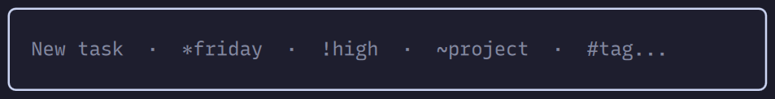
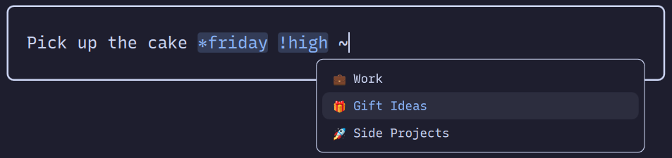
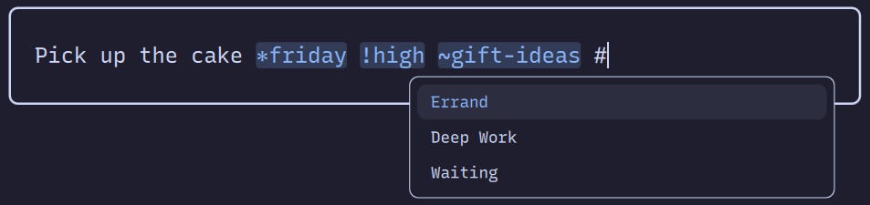

# ticktick-quick-add

An [Omarchy](https://omarchy.org/) overlay plugin that parks a TickTick task prompt near the
top of the screen, Spotlight style.



`omarchy-menu-input` already does free-text capture, but its card is stuck in the center of
the screen. Moving it means forking all of `Menu.qml`, so this plugin moves the prompt and
leaves the SUPER menu alone.

## Install

```bash
omarchy plugin add https://github.com/bnrobinson93/omarchy-ticktick-quick-add.git
omarchy plugin enable ticktick-quick-add
```

Updates come from `omarchy plugin update ticktick-quick-add`.

Sending tasks needs your own TickTick API credentials.

<details>
<summary>Get a TickTick client ID and secret</summary>

1. Sign in to the [TickTick Developer Center](https://developer.ticktick.com/manage) with
   your TickTick account
2. Create a new app. The name can be anything
3. Open the app and set its OAuth redirect URL to exactly `http://127.0.0.1`.
   `ticktask.sh` hardcodes that value, and TickTick needs the two to match
4. Copy the client ID and client secret into `~/.config/ticktask/config`:

   ```bash
   CLIENT_ID="..."
   CLIENT_SECRET="..."
   ```

5. Lock the file down, then run the script once from a terminal to get a token:

   ```bash
   chmod 600 ~/.config/ticktask/config
   ~/.config/omarchy/plugins/ticktick-quick-add/ticktask.sh "hello"
   ```

6. Approve access in the browser. The page you land on will fail to load, which is expected.
   Paste its URL into the terminal

Running that command creates a real task called "hello", so you'll want to delete it. The
token is saved to `~/.local/share/ticktask/token`.

Registration and sign-in are TickTick's own process, so if these steps stop matching, the
[TickTick Open API docs](https://developer.ticktick.com/docs/index.html#/openapi) have the
current version.

</details>

## Usage

Bind this to a key. Ctrl+Shift+A is free in the Omarchy defaults:

```bash
omarchy-shell shell summon ticktick-quick-add
```

The prompt parses four optional markers out of the line, in any order:

| Marker | Example | What it does |
| --- | --- | --- |
| `*date` | `*friday`, `*today 9:30am` | Due date, any string GNU `date` understands |
| `!priority` | `!high`, `!medium`, `!low` | Priority |
| `~project` | `~work` | Assigns to a project, fuzzy-matched against your project list |
| `#tag` | `#errand` | Adds a tag |

Whatever is left becomes the title, and recognised markers turn the theme's accent color as
you type. A marker that doesn't resolve, like `*blah`, stays in the title.

Typing `~`, `!`, or `#` in the title opens a list of your projects, priorities, or tags, and
narrows it as you keep typing.



The list shows project names as TickTick has them, emoji and all. Picking one writes a plain
version into the title, so `🎁 Gift Ideas` becomes `~gift-ideas`. Archived projects are left out,
and tags show their display name but insert the real one.



| Input, while the list is open | What it does |
| --- | --- |
| `Up` / `Down` | Moves through the list |
| `Tab` / `Enter` | Puts the highlighted item in the title |
| `Esc` | Closes the list and leaves the title alone |

Once the list is closed, every key goes back to the table below. Projects and tags come from a
cache in `~/.local/share/ticktask/`, refreshed in the background each time the prompt opens. If
there's no network the last cache stays, and typing a marker by hand works as before.

Tab opens the description, which is plain text and never parsed. Tab again opens subtasks, one
per line. Subtasks only understand `*date`, because that's all TickTick's API takes on one.
Anything else stays in the subtask's text.

| Input | What it does |
| --- | --- |
| `Enter` | Sends the task and closes the prompt |
| `Tab` / `Shift+Tab` | Moves between title, description, and subtasks |
| `Shift+Enter` | Same as `Tab`, or starts the next subtask |
| `Ctrl+Enter` | New line in the description |
| `Esc` | Clears everything, or closes the prompt if it's already empty |
| Click outside the card, or the hotkey again | Closes the prompt and keeps the draft |

Reopening picks up right where you left off, so you can click away, copy something, and come
back to paste it. A pasted list becomes one subtask per line, and the title flattens newlines
to spaces.

The draft clears only once the send succeeds. If it fails you get a notification, the draft
stays put, and a copy lands in `~/.local/share/ticktask/error_tasks`. Drafts live in memory, so
`omarchy restart shell` drops them.

Editing plugin files in `~/.config/omarchy/plugins/ticktick-quick-add/` needs
`omarchy restart shell` to take effect.

## Remove

```bash
omarchy plugin remove ticktick-quick-add
```

## License and dependencies

MIT, see [LICENSE](LICENSE).

| Dependency | Required | Why |
| --- | --- | --- |
| Omarchy 4 (Quattro) with Quickshell | yes | the shell that hosts the plugin |
| `curl`, `jq` | yes | `ticktask.sh` talks to the TickTick API with them |

`ticktask.sh` is derived from [UnkwUsr/ticktask](https://github.com/UnkwUsr/ticktask), MIT.
